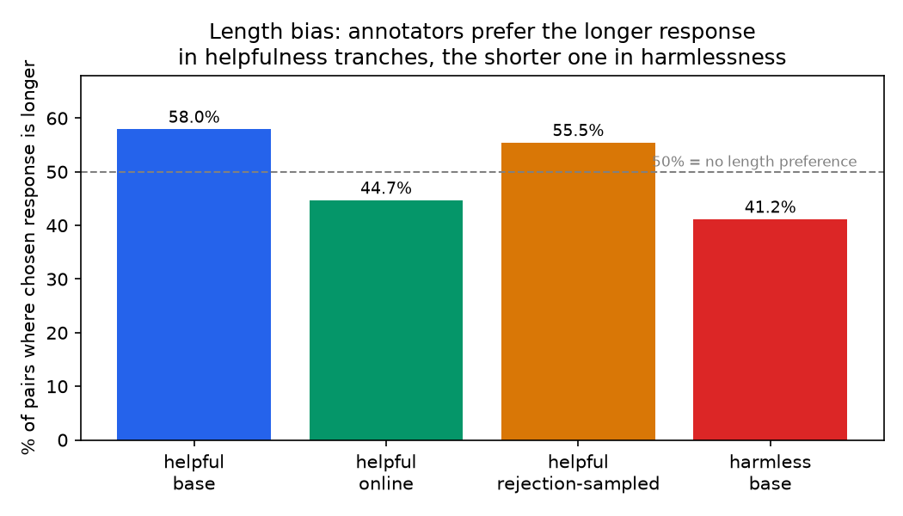
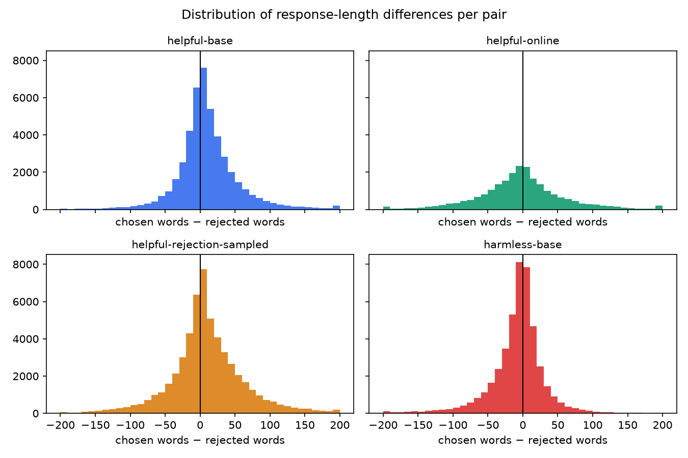
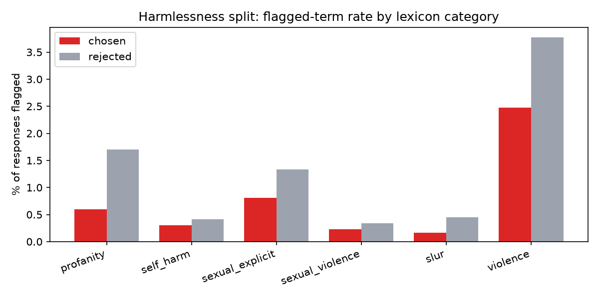
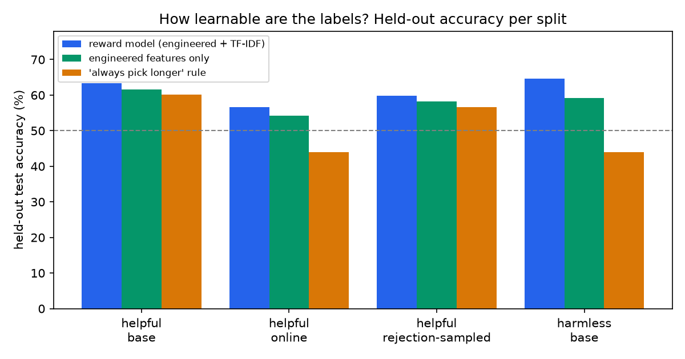
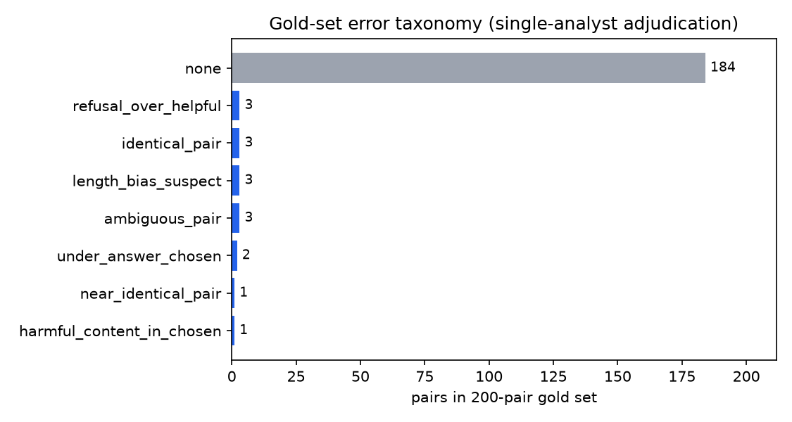

# RLHF Preference Data - Annotation Quality Audit

> **Content warning.** This project audits the Anthropic HH-RLHF dataset,
> whose harmlessness split contains offensive language, slurs and harmful
> requests **by design** - that is what makes it useful for safety training,
> and it is also where annotation quality matters most. The user who
> commissioned this portfolio project explicitly approved covering the
> harmlessness split in full. This README reports the audit statistically,
> keeps quoted examples to a minimum, and uses only mild ones.

> **Simulated engagement.** The client brief behind this project is a
> simulation created for portfolio purposes; there is no real client. See
> `CLIENT_BRIEF.md` for the full disclosure. The data, code and numbers are
> entirely real and reproducible.

## Executive summary

An AI startup (simulated) is about to train a reward model on **169,352
human preference pairs** from the public Anthropic HH-RLHF corpus and asked
a simple question first: *what do our labels actually say?* This audit
answers that question across the corpus's four published splits - three
helpfulness tranches (`helpful-base`, `helpful-online`,
`helpful-rejection-sampled`) and one harmlessness tranche (`harmless-base`).

**Headline findings**

1. **Length bias is real, and it flips sign by task.** In `helpful-base`,
   the chosen response is the longer one in **58.0%** of pairs, and a trivial
   "always pick the longer response" rule reproduces annotator choices with
   **59.1% accuracy**. In `harmless-base` the pattern inverts: chosen
   responses are longer in only **41.2%** of pairs and the same rule scores
   **42.2% — below chance**. A reward model trained on this data learns
   "be verbose" from helpfulness and "be brief" from harmlessness, whether
   or not anyone intended that.
2. **Flagged content survives in chosen harmlessness responses.** Using the
   transparent lexicon in `data/curated/lexicon.csv` as a surface proxy,
   **4.44% of chosen** harmlessness responses still contain at least one
   flagged term, versus 7.58% of rejected ones. Annotators reduced flagged
   content; they did not eliminate it. In the helpfulness tranches the
   chosen responses are flagged slightly *more* often than the rejected
   ones (e.g. 0.76% vs 0.58% in `helpful-base`) — nobody was screening for
   it there.
3. **Hundreds of pairs carry no signal at all.** The corpus contains **776
   identical pairs** (chosen and rejected responses textually identical),
   667 of them in `helpful-rejection-sampled` alone (1.21% of that split),
   plus 134 near-identical pairs and thousands of pairs where one side is a
   ≤2-word stub.
4. **The labels are learnable, but only modestly.** A transparent logistic
   preference model (engineered features + TF-IDF) reaches **56.6–64.7%
   held-out accuracy** per split - always above the length-only rule, far
   from the ceiling. The gap is where annotator subjectivity and label
   noise live.
5. **A 200-pair adjudicated gold set** (50 per split) was built with an
   explicit error taxonomy. Single-analyst adjudication agreed with the
   original labels on **96.9% of decisive pairs** - a rule-based audit only
   overturns labels on strong signals, so this is *not* comparable to
   inter-annotator agreement (which cannot be computed here at all: the
   public release has no annotator IDs).

**Recommendations for the startup's annotation operation**

- Rewrite the annotation guideline around length: length must follow the
  request, never drive the preference (the full guideline written for this
  engagement is in `ANNOTATION_GUIDELINE.md`).
- Filter identical and near-identical pairs out of reward-model training.
- Add a harmlessness second pass: lexicon pre-screening of *chosen*
  responses, with human review of the flagged remainder.
- Calibrate new annotators on the gold set before production labelling,
  and review every disagreement with a lead.
- In the client's own pipeline, double-label a rotating 5% sample and
  store annotator IDs from day one, so real inter-annotator agreement is
  measurable — for this public corpus it is unknowable.



## The data

Anthropic HH-RLHF (MIT license), downloaded from the official GitHub
repository by `scripts/01_download.py` (the files are Git-LFS objects; the
script handles that and records SHA-256 hashes in
`data/raw/download_manifest.json`). Each record is a pair of transcripts
that share a prompt and differ only in the final assistant response.

| Split | Train pairs | Test pairs | Median chosen words | Median rejected words |
|---|---:|---:|---:|---:|
| helpful-base | 43,835 | 2,354 | 32 | 24 |
| helpful-online | 22,007 | 1,137 | 98 | 102 |
| helpful-rejection-sampled | 52,421 | 2,749 | 54 | 43 |
| harmless-base | 42,537 | 2,312 | 20 | 26 |

A typical helpfulness pair opens like this (benign example, truncated):
both transcripts share *"Human: Hi, I want to learn to play horseshoes. Can
you teach me?"* and the same first assistant reply; they diverge only in the
final response, one of which the annotator preferred. A typical
harmlessness prompt is adversarial — for example a user asking for a list of
English swear words — which is exactly why context, not word lists, has to
decide those labels (see the guideline, §3.3).

## Findings in detail

### Length bias

| Split | Pairs | Chosen longer | Mean length diff (words) | "Pick longer" accuracy |
|---|---:|---:|---:|---:|
| helpful-base | 46,189 | 57.96% | +9.8 | 59.07% |
| helpful-online | 23,144 | 44.72% | −3.5 | 45.52% |
| helpful-rejection-sampled | 55,170 | 55.48% | +8.9 | 57.10% |
| harmless-base | 44,849 | 41.17% | −8.3 | 42.16% |

`helpful-online` is the interesting middle case: its responses come from an
iterated RLHF process, chosen answers are slightly *shorter* than rejected
ones, and the length rule fails there too. Length preference is a property
of the annotation setup, not of good answers.



### Label leakage (lexicon proxy)

Share of responses containing at least one lexicon-flagged term, "any"
category, chosen vs rejected: helpful-base 0.76% / 0.58%, helpful-online
1.79% / 2.19%, helpful-rejection-sampled 0.94% / 0.81%, harmless-base
**4.44% / 7.58%**. Inside the harmlessness split, the chosen-vs-rejected
gap holds in every category (profanity 0.60% / 1.70%, violence 2.47% /
3.77%, sexual-explicit 0.81% / 1.33%, slurs 0.17% / 0.45%, self-harm 0.30% /
0.42%, sexual-violence 0.23% / 0.34%) — the direction is right; the residue
is the finding.



### Noise signals

| Signal | helpful-base | helpful-online | helpful-rejection-sampled | harmless-base |
|---|---:|---:|---:|---:|
| Identical pairs | 63 | 46 | **667** | 0 |
| Near-identical pairs (Jaccard ≥ 0.95) | 0 | 130 | 3 | 1 |
| Pairs with a ≤2-word response | 2,302 | 371 | 2,394 | 2,094 |
| Role-bleed transcripts | 0 | 10 | 1 | 0 |
| Exact duplicate rows (within split) | 0 | 0 | 0 | 0 |

A further 329 pairs have chosen/rejected transcripts whose prompt prefixes
differ slightly (mostly turn-boundary artefacts of the release); they are
counted in `data/results/split_profile.csv`.

### Reward model

Logistic preference model, Bradley–Terry style on feature differences,
trained per split on the official train file, evaluated on the official
test file:

| Split | Full model | Engineered only | Length-only rule |
|---|---:|---:|---:|
| helpful-base | 63.42% | 61.53% | 60.07% |
| helpful-online | 56.55% | 54.27% | 43.98% |
| helpful-rejection-sampled | 59.88% | 58.28% | 56.60% |
| harmless-base | 64.66% | 59.13% | 43.92% |



### Gold set and error taxonomy

200 pairs (50 per split, stratified across random, model-disagreement,
length-extreme, flagged-chosen and tiny-response strata) were adjudicated
against the guideline by documented rules; every gold row stores the
measured signals behind its verdict as its rationale. Results: 190 agree,
6 disagree, 4 invalid. Error categories found: length-bias-suspect 3,
identical pair 3, refusal-over-helpful 3, ambiguous pair 3,
under-answer-chosen 2, harmful-content-in-chosen 1, near-identical pair 1
(plus 184 pairs with no issue). Full data: `data/results/gold_set.csv`.



## Methods

- **Parsing.** The final assistant response is the text after the last
  `Assistant:` marker; everything before it is the shared prompt. Lengths
  are whitespace word counts, not model-tokenizer tokens.
- **Length bias.** Per split: share of pairs where the chosen response is
  longer, mean/median length difference, and the accuracy of the rule
  "always pick the longer response" (ties score half).
- **Noise.** Exact identity, word-set Jaccard ≥ 0.95 for near-identity,
  exact duplicate rows after normalisation, transcripts containing a
  further `Human:` turn inside the final response, and ≤2-word responses.
- **Leakage.** The lexicon (`data/curated/lexicon.csv`, 64 terms in 6
  categories, each with a usage note) is matched on word boundaries against
  the final responses. It is a **surface proxy**: it produces false
  positives (medical, news, support and quoted contexts) and false
  negatives (harm with no flagged vocabulary). It is used to compare
  chosen vs rejected *rates*, never to label individual pairs as harmful.
- **Reward model.** Per split, logistic regression on the difference of
  per-response features (Bradley–Terry form), trained on the symmetrised
  train set and evaluated once on the official test set. Features:
  engineered response statistics (length, structure, refusal/apology
  markers, lexicon counts) and, for the full model, 3,000 TF-IDF features.
  One implementation note, because it silently inverts results if missed:
  difference features are **scaled but not centred** — centring removes
  exactly the mean shift that carries the preference signal, and during
  development a centred variant collapsed to a constant 0.5 model with
  all-zero coefficients. Exact 0.5 predictions are scored as half-correct
  in all reported accuracies.
- **Transformer model — not run, deliberately.** A DistilBERT fine-tune was
  scoped and rejected for this engagement: the working environment offers
  ~1.5 shared CPUs and 6 GB RAM, and fine-tuning on tens of thousands of
  pairs would take many hours. Rather than report an unreproducible or
  invented number, the audit ships the transparent logistic baseline and
  states this decision here and in `data/results/summary.json`.
- **Gold set.** Stratified sampling plus rule-operationalised adjudication
  by a single analyst (see `scripts/05_gold_set.py` for the exact rules
  and `ANNOTATION_GUIDELINE.md` for the human-readable version).

## Data honesty and limitations

- **Simulated client, real data.** The engagement framing is a portfolio
  simulation (see `CLIENT_BRIEF.md`). The dataset is the genuine public
  HH-RLHF release; all statistics were computed from it by the scripts in
  this repository.
- **No inter-annotator agreement is reported, because none can be.** The
  public release contains no annotator IDs and no doubly-labelled pairs.
  The 96.9% "audit agreement" is agreement between the original labels and
  one analyst's rule-based adjudication of a 200-pair sample — a much
  weaker claim, and it is labelled as such everywhere it appears.
- **The lexicon is not ground truth about harm.** Category rates are
  comparative signals only. Several lexicon terms are ambiguous by design
  and their notes say so.
- **Adjudication rules are proxies too.** A "disagree" verdict means the
  pair trips a documented, guideline-derived rule (e.g. the chosen response
  carries slur/sexual-violence terms while the rejected one carries none).
  Quoted or analytical context can make individual verdicts debatable;
  the rationale column records the signals so a human reviewer can
  overrule them.
- **Model accuracy is a diagnostic, not a benchmark.** The logistic model
  exists to measure how learnable the labels are and where they resist
  learning; it is not a production reward model.
- **Content.** The harmlessness data includes requests for, and responses
  containing, offensive and harmful material. The gold-set CSV contains
  truncated excerpts of real pairs, including from that split; handle it
  accordingly.

## Repository guide

| Path | Contents |
|---|---|
| `CLIENT_BRIEF.md` | The simulated client brief, scope and disclosure |
| `ANNOTATION_GUIDELINE.md` | The annotation guideline deliverable (helpfulness + harmlessness rubric, decision rules, quality process) |
| `scripts/01_download.py` | Downloads HH-RLHF from the official GitHub repo (Git-LFS aware), writes a hashed manifest |
| `scripts/02_profile_length_bias.py` | Dataset profile, length-bias tables, per-pair length features |
| `scripts/03_noise_leakage.py` | Noise signals and lexicon leakage audit |
| `scripts/04_reward_model.py` | Logistic preference model, held-out accuracy per split |
| `scripts/05_gold_set.py` | Gold-set sampling and adjudication, error taxonomy, `summary.json` |
| `scripts/06_charts.py` | All charts, drawn only from result tables |
| `scripts/07_dashboard.py` | Static HTML dashboard, generated from result tables |
| `data/curated/lexicon.csv` | The documented profanity/harm lexicon (proxy, with per-term notes) |
| `data/results/` | All result tables: profile, length bias, leakage, noise, model metrics, gold set, taxonomy, summary |
| `charts/` | Six charts used in this README and the dashboard |
| `dashboard/index.html` | Client-facing dashboard (statistics only, no quoted harmful examples) |
| `tests/test_project.py` | Consistency tests across the deliverables (12 tests) |

## Reproduce

```bash
python3 -m venv .venv && source .venv/bin/activate
pip install -r requirements.txt
python scripts/01_download.py            # ~79 MB, writes data/raw/
python scripts/02_profile_length_bias.py
python scripts/03_noise_leakage.py
python scripts/04_reward_model.py        # a few minutes on modest hardware
python scripts/05_gold_set.py
python scripts/06_charts.py
python scripts/07_dashboard.py
pytest tests/
```

Raw downloads and intermediate per-pair tables live in `data/raw/` and
`data/processed/`; they are excluded from the repository (see `.gitignore`)
and are fully recreated by the pipeline above.

## License and attribution

Code and documentation in this repository: MIT. Data: Anthropic HH-RLHF,
MIT license, © Anthropic — Bai et al., *Training a Helpful and Harmless
Assistant with Reinforcement Learning from Human Feedback* (2022), and
Ganguli et al., *Red Teaming Language Models to Reduce Harms* (2022).
This project is an independent audit and is not affiliated with Anthropic.
